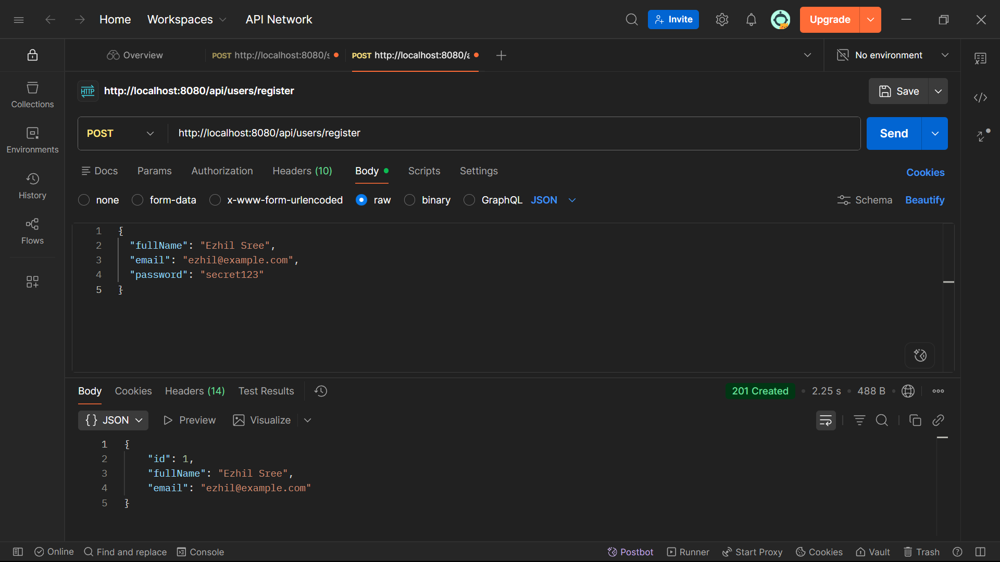
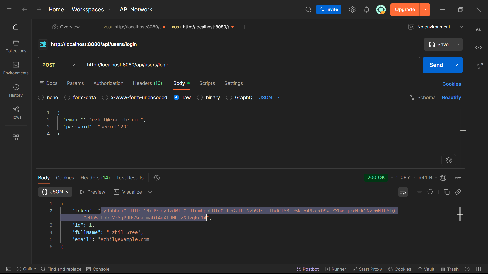
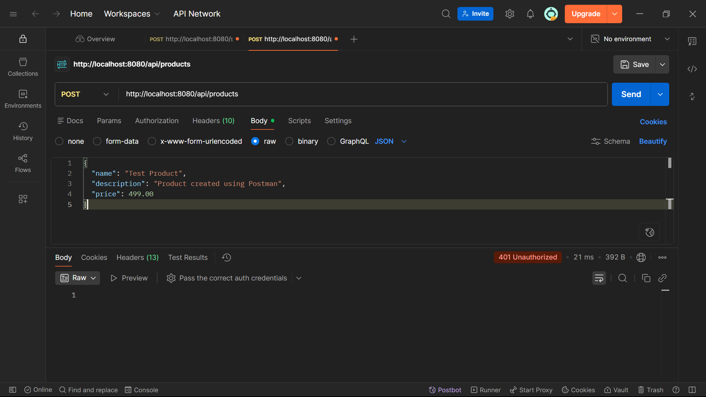
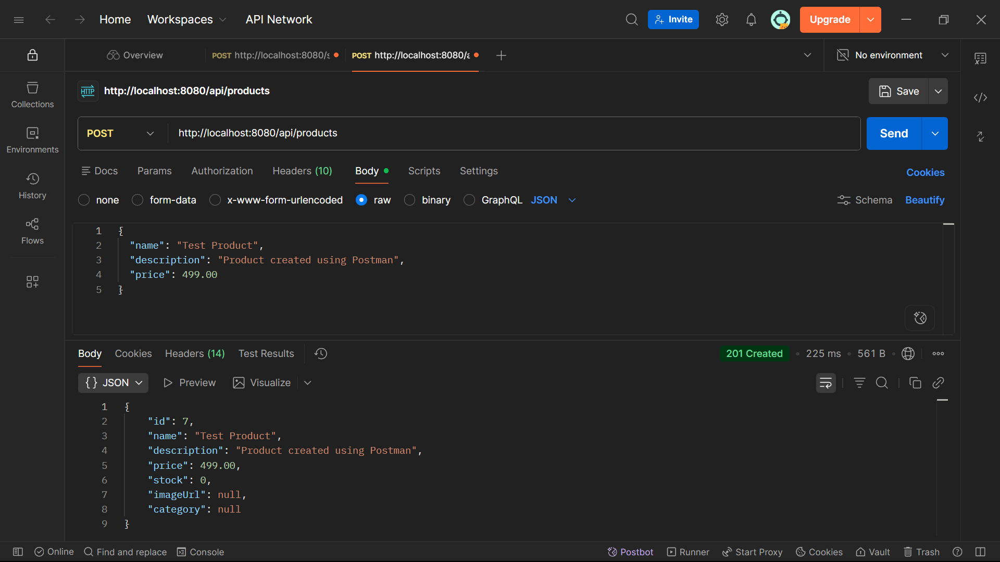
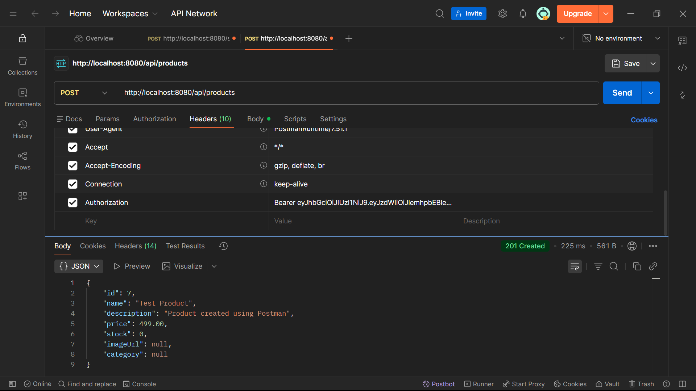

# E-Commerce Backend | Spring Boot & JWT

A simple e-commerce backend project developed using Spring Boot, MySQL and JWT authentication. This project includes product and category APIs, user registration and login, and JWT-based security for protected API requests.

This project covers the backend development up to JWT authentication and testing. The Orders module and React frontend are not included in the current version.

## Features

- Create, view, update and delete products
- Create and view categories
- User registration and login
- Password encryption using BCrypt
- JWT token generation and validation
- Secure API endpoints using Spring Security
- Request validation and exception handling
- API testing using Postman

## Tech Stack

| Technology | Purpose |
|---|---|
| Java 17 | Application language |
| Spring Boot 3.5.x | Backend framework |
| Spring Web | REST API development |
| Spring Data JPA | Database operations |
| Hibernate | ORM |
| MySQL 8 | Database |
| Spring Security | API security |
| JJWT 0.12.6 | JWT authentication |
| Maven | Build and dependency management |
| Postman | API testing |

## Project Structure

```text
src/main/java/com/shop/ecommerce/
├── config/
├── controller/
├── dto/
├── exception/
├── model/
├── repository/
├── security/
└── service/

src/main/resources/
└── application.properties

postman/
└── Ecommerce-JWT-Phase3.postman_collection.json

JWT_TESTING_CHECKLIST.md
```

## Getting Started

### Prerequisites

- JDK 17
- MySQL 8
- MySQL Workbench
- Maven
- Postman
- VS Code or any Java IDE

### 1. Create the Database

Open MySQL Workbench and execute:

```sql
CREATE DATABASE ecommerce_db;
```

### 2. Configure Database Connection

Open:

`src/main/resources/application.properties`

Update your MySQL username and password:

```properties
spring.datasource.url=jdbc:mysql://localhost:3306/ecommerce_db?useSSL=false&allowPublicKeyRetrieval=true&serverTimezone=UTC
spring.datasource.username=root
spring.datasource.password=YOUR_MYSQL_PASSWORD
```

Replace `YOUR_MYSQL_PASSWORD` with your MySQL password.

The project uses `spring.jpa.hibernate.ddl-auto=update` to create or update database tables during development.

Keep your database password and JWT secret private. Do not upload real credentials to GitHub.

### 3. Run the Application

Open the project folder containing `pom.xml` in VS Code.

Open the terminal and run:

```bash
mvn spring-boot:run
```

You can also run `EcommerceApplication.java` directly from your IDE.

The application runs at:

```text
http://localhost:8080
```

Check the application using:

```http
GET http://localhost:8080/api/hello
```

## API Endpoints

Base URL: `http://localhost:8080`

| Method | Endpoint | Access | Description |
|---|---|---|---|
| GET | `/api/hello` | Public | Check application |
| GET | `/api/products` | Public | Get all products |
| GET | `/api/products/{id}` | Public | Get product by ID |
| POST | `/api/products` | JWT required | Create product |
| PUT | `/api/products/{id}` | JWT required | Update product |
| DELETE | `/api/products/{id}` | JWT required | Delete product |
| GET | `/api/categories` | Public | Get all categories |
| POST | `/api/categories` | JWT required | Create category |
| POST | `/api/users/register` | Public | Register user |
| POST | `/api/users/login` | Public | Login and get JWT |

## JWT Authentication

The authentication flow works as follows:

1. Register a new user.
2. Login using the registered email and password.
3. The backend generates a JWT token.
4. Copy the token from the login response.
5. Use the token to access protected APIs.

In Postman, select **Authorization → Bearer Token** and paste your JWT.

Example:

```http
Authorization: Bearer <your-token>
```

## Postman Testing

I used Postman to test the APIs and check the responses.

The following screenshots show the requests I tested:

- User registration
- User login and JWT token generation
- Accessing a protected API without a token
- Accessing a protected API with a valid token

The screenshots are available in the `docs/screenshots/` folder.

## Screenshots

### Registration


### Login


### Request Without Token


### Request With Token





## Learning Notes

This project helped me understand how to build REST APIs using Spring Boot, connect the application with MySQL, perform database operations using JPA, and secure APIs using Spring Security and JWT.

## Author

**Ezhil Sree**

Student Project | Spring Boot | MySQL | JWT Authentication

# E-Commerce Backend | Spring Boot & JWT

A simple e-commerce backend project developed using Spring Boot, MySQL and JWT authentication. This project includes product and category APIs, user registration and login, and JWT-based security for protected API requests.

This project covers the backend development up to JWT authentication and testing. The Orders module and React frontend are not included in the current version.

## Features

- Create, view, update and delete products
- Create and view categories
- User registration and login
- Password encryption using BCrypt
- JWT token generation and validation
- Secure API endpoints using Spring Security
- Request validation and exception handling
- API testing using Postman

## Tech Stack

| Technology | Purpose |
|---|---|
| Java 17 | Application language |
| Spring Boot 3.5.x | Backend framework |
| Spring Web | REST API development |
| Spring Data JPA | Database operations |
| Hibernate | ORM |
| MySQL 8 | Database |
| Spring Security | API security |
| JJWT 0.12.6 | JWT authentication |
| Maven | Build and dependency management |
| Postman | API testing |

## Project Structure

```text
src/main/java/com/shop/ecommerce/
├── config/
├── controller/
├── dto/
├── exception/
├── model/
├── repository/
├── security/
└── service/

src/main/resources/
└── application.properties

postman/
└── Ecommerce-JWT-Phase3.postman_collection.json

JWT_TESTING_CHECKLIST.md
```

## Getting Started

### Prerequisites

- JDK 17
- MySQL 8
- MySQL Workbench
- Maven
- Postman
- VS Code or any Java IDE

### 1. Create the Database

Open MySQL Workbench and execute:

```sql
CREATE DATABASE ecommerce_db;
```

### 2. Configure Database Connection

Open:

`src/main/resources/application.properties`

Update your MySQL username and password:

```properties
spring.datasource.url=jdbc:mysql://localhost:3306/ecommerce_db?useSSL=false&allowPublicKeyRetrieval=true&serverTimezone=UTC
spring.datasource.username=root
spring.datasource.password=YOUR_MYSQL_PASSWORD
```

Replace `YOUR_MYSQL_PASSWORD` with your MySQL password.

The project uses `spring.jpa.hibernate.ddl-auto=update` to create or update database tables during development.

Keep your database password and JWT secret private. Do not upload real credentials to GitHub.

### 3. Run the Application

Open the project folder containing `pom.xml` in VS Code.

Open the terminal and run:

```bash
mvn spring-boot:run
```

You can also run `EcommerceApplication.java` directly from your IDE.

The application runs at:

```text
http://localhost:8080
```

Check the application using:

```http
GET http://localhost:8080/api/hello
```

## API Endpoints

Base URL: `http://localhost:8080`

| Method | Endpoint | Access | Description |
|---|---|---|---|
| GET | `/api/hello` | Public | Check application |
| GET | `/api/products` | Public | Get all products |
| GET | `/api/products/{id}` | Public | Get product by ID |
| POST | `/api/products` | JWT required | Create product |
| PUT | `/api/products/{id}` | JWT required | Update product |
| DELETE | `/api/products/{id}` | JWT required | Delete product |
| GET | `/api/categories` | Public | Get all categories |
| POST | `/api/categories` | JWT required | Create category |
| POST | `/api/users/register` | Public | Register user |
| POST | `/api/users/login` | Public | Login and get JWT |

## JWT Authentication

The authentication flow works as follows:

1. Register a new user.
2. Login using the registered email and password.
3. The backend generates a JWT token.
4. Copy the token from the login response.
5. Use the token to access protected APIs.

In Postman, select **Authorization → Bearer Token** and paste your JWT.

Example:

```http
Authorization: Bearer <your-token>
```

## Postman Testing

I used Postman to test the APIs and check the responses.

The following screenshots show the requests I tested:

- User registration
- User login and JWT token generation
- Accessing a protected API without a token
- Accessing a protected API with a valid token

The screenshots are available in the `docs/screenshots/` folder.

### Registration


### Login


### Request Without Token


### Request With Token


## Testing Checklist

The following cases can be tested using Postman:

- Successful user registration
- Duplicate email registration
- Successful login
- Login with incorrect password
- Accessing protected APIs without a token
- Accessing protected APIs with a valid token
- Accessing protected APIs with an invalid token
- Checking password encryption in the database

Refer to [`JWT_TESTING_CHECKLIST.md`](JWT_TESTING_CHECKLIST.md) for the testing steps.

## Learning Notes

This project helped me understand how to build REST APIs using Spring Boot, connect the application with MySQL, perform database operations using JPA, and secure APIs using Spring Security and JWT.

## Author

**Ezhil Sree**

Student Project | Spring Boot | MySQL | JWT Authentication
